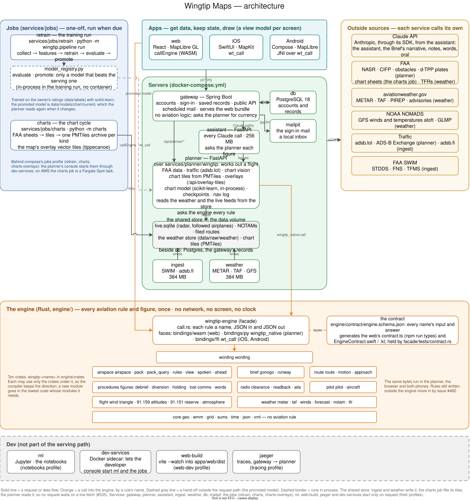

# Wingtip Maps


[](https://github.com/asdaq-samir/wingtip/actions/workflows/ci.yml)
[](LICENSE)

**A flight planner for VFR and IFR pilots.** The FAA's charts on a map
that works like Apple Maps, and for a flight: the route, the checkpoints
you will see out of the window, the nav log, and a brief that ends in a
go or no-go. On the web, the iPhone and Android.

> **A planning aid.** It does not replace an official weather briefing
> (1800wxbrief.com), current FAA charts, or the pilot in command's
> judgement and authority (14 CFR 91.3, 91.103). Its checkpoints are a
> model's suggestions: check them against the chart.



## What's in it

- **The FAA's own charts.** Sectional, TAC and IFR low and high enroute
  charts, drawn from the FAA's files every 56-day cycle, at double
  density for a sharp phone screen. The next cycle is drawn ahead and
  switches over on its date.
- **Airspace that reads like ForeFlight.** Class B, C and D rings with
  their altitudes, special-use areas, airports in the sectional's colours
  with their flight category, navaids and fixes.
- **Route and nav log.** Type the airports; get the course, checkpoints
  picked off the chart by a trained model, legal cruising altitudes
  (four plans: lowest, highest, fastest, least fuel), and every leg's
  heading, groundspeed, time and fuel in the forecast winds.
- **The Brief.** A verdict and at most three things to do, then the
  weather, NOTAMs, TFRs, runways, fuel, weight and balance, and the risk.
  The verdict and the findings are the engine's own words.
- **IFR planning.** Published procedures, holds, alternates (14 CFR
  91.169), plates, and forecast icing along the route.
- **Live FAA data over SWIM.** NOTAMs, runway visual range, the D-ATIS,
  ground stops and delays, ITWS wind-shear and microburst alerts, and
  special-use airspace going hot or cold. The planner says when a feed
  goes quiet, so silence never reads as a clear sky.
- **Traffic.** ADS-B traffic on the map, and airplanes you follow.
- **Dry run.** Fly the route on the map before you fly it.
- **Weather on the map.** Each field wears its flight category, its
  wind as an arrow (red past your airplane's demonstrated crosswind) and,
  close in, a station model; a field whose forecast gets worse by your
  arrival is marked, and the app tells you when the route's weather
  turns worse after the Brief.
- **One search, like Apple Maps.** Airports, waypoints, airplanes and
  questions from one field, typed or asked by voice (recognised on the
  phone); each thing opens as a card over it.
- **iPhone and Android apps.** Native SwiftUI and Jetpack Compose, with
  instruments and alerts ahead in flight, on-device AI where the phone
  has it, and an Apple Watch app. Four looks on each, Native (the
  platform as it comes) among them.
- **AI on the phone, free.** Ask about your flight in your own words on
  an iPhone with Apple Intelligence (and Siri) or an Android phone with
  Gemini Nano; every figure in the answer is the engine's or the
  planner's. The server's Claude features (Ask on the web, the written
  briefing, the words, the mock oral) are built but off until the
  subscription is decided ([decision 0035](docs/decisions/0035-claude-off-until-subscription.md)).
- **For students and instructors.** Logbook, currency, endorsements,
  approach lessons, a mock oral exam and a debrief.

## How it fits together

Four layers, each with one job, so every aviation rule is written once and
every app gets the same answer.

| Layer | What it does | More |
|---|---|---|
| **Engine** (Rust, `engine/`) | Every aviation rule and figure: altitudes, winds, fuel, weather limits, Go / No-Go, procedures. No network, no screen, no clock. Runs inside the planner, the browser (WebAssembly) and both phones. | [engine/README.md](engine/README.md) |
| **Planner and services** (Python, `services/`) | The planner works out a flight and asks the engine every rule; `ingest` reads the live FAA feeds, `weather` fetches the weather, `assistant` makes every Claude call, and the jobs draw each chart cycle. | [ARCHITECTURE.md](docs/ARCHITECTURE.md) |
| **Gateway** (Spring Boot, `services/gateway/`) | Who the pilot is and what they saved: accounts, sign-in, records, the public API, mail. No aviation logic. | [gateway](services/gateway/README.md) |
| **Apps** (`apps/`) | Web (React, MapLibre), iOS (SwiftUI) and Android (Compose): get data, keep state, draw, and ask the engine the rest. | [web](apps/web/README.md), [iOS](docs/NATIVE.md), [Android](docs/NATIVE-ANDROID.md) |

A few terms you will meet in the code:

- **NASR**: the FAA's National Airspace System Resources, its 28-day data
  set of airports, runways, navaids, fixes and airspace.
- **CIFP**: the FAA's Coded Instrument Flight Procedures, the SIDs, STARs
  and approaches in machine-readable form.
- **SWIM**: the FAA's System Wide Information Management, the live feeds
  (STDDS radar, FNS NOTAMs, TFMS flow, ITWS weather, SFDPS airspace).
- **PMTiles**: a single-file map tile archive read in byte ranges; each
  chart kind is one, and so are the map's overlays.

## Run it locally

You need Docker Desktop (with 8 GB or more of memory for it), Git and
`make` (it ships with macOS); nothing else is installed natively.

```bash
git clone https://github.com/asdaq-samir/wingtip.git
cd wingtip
make dev
```

`make dev` checks Docker, makes `.env` from `.env.example` if there is
none, builds the images, starts the stack, waits until every service is
healthy and prints the addresses. `make` alone lists the other commands
(`make stop`, `make logs s=planner`, `make check`). In VS Code, "Reopen in
Container" uses `.devcontainer/`
([LOCAL-DEV.md](docs/LOCAL-DEV.md#in-a-vs-code-dev-container)).

1. Open [localhost:8080/app](http://localhost:8080/app). The first start
   fetches the FAA's data, so give the planner a few minutes.
2. To sign in, enter an address in the app, then open the link from the
   local inbox at [localhost:8025](http://localhost:8025) (Mailpit).
3. The Claude features are off ([decision 0035](docs/decisions/0035-claude-off-until-subscription.md)).
   To try them on your machine, `.env.example` names the three settings
   (the key, `APP_CLAUDE_FEATURES` and `COMPOSE_PROFILES=claude`).
   Everything else works without them.

On a phone over the Wi-Fi: `infra/local-https/make-certs.sh <your Mac's
address>`, three lines in `.env`, and `https://<address>:8443/app`
([LOCAL-DEV.md](docs/LOCAL-DEV.md#on-a-phone-over-the-wi-fi)). The owner's
stack goes live with `scripts/dev/go-live.sh`.

## Repository layout

```
apps/        web/ (React), ios/ (SwiftUI), android/ (Compose)
engine/      the Rust engine: facade/, crates/ (thirteen domains), contract/, bindings/
services/    planner/, ingest/, weather/, assistant/, gateway/, jobs/, Dockerfile.base
ml/          the notebooks and their image
infra/       AWS CloudFormation, the server's compose file, CI's, local HTTPS
scripts/     build/ (WebAssembly, the phones' models), ci/, dev/ (checks, go-live, tidy)
tools/       xplane-driver/ (the X-Plane 12 trial's replay plugin, docs/XPLANE-TRIAL.md)
data/        fetched and made data (mostly gitignored); stock aircraft profiles
docs/        the docs below, and the architecture diagrams
```

## Docs

| | |
|---|---|
| [docs/README.md](docs/README.md) | The index of every doc |
| [ARCHITECTURE.md](docs/ARCHITECTURE.md) | Services, ports, the shared stores, outside sources |
| [LOCAL-DEV.md](docs/LOCAL-DEV.md) | Running it, the phone, the jobs, the developer scripts |
| [DATA.md](docs/DATA.md) | The database, the data folder, the chart model |
| [CI.md](docs/CI.md) | What CI runs and what gates a merge |
| [versions.md](docs/versions.md) | What each part pins, the upgrades coming, and how one lands |
| [README-AWS.md](docs/README-AWS.md) | The AWS design and how to deploy it |
| [decisions/](docs/decisions/README.md) | The owner's standing decisions and why, so none is undone by accident |
| [CONTRIBUTING.md](.github/CONTRIBUTING.md) | Where a change goes and how it lands |

## Licence and credits

MIT ([LICENSE](LICENSE)). Charts, aeronautical data and live feeds from
the FAA; weather from NOAA and aviationweather.gov; traffic from adsb.lol,
ADS-B Exchange and adsb.fi; imagery from the USGS. Built with Rust,
TypeScript and React, Swift, Kotlin, Python and Java, and the Claude API.
