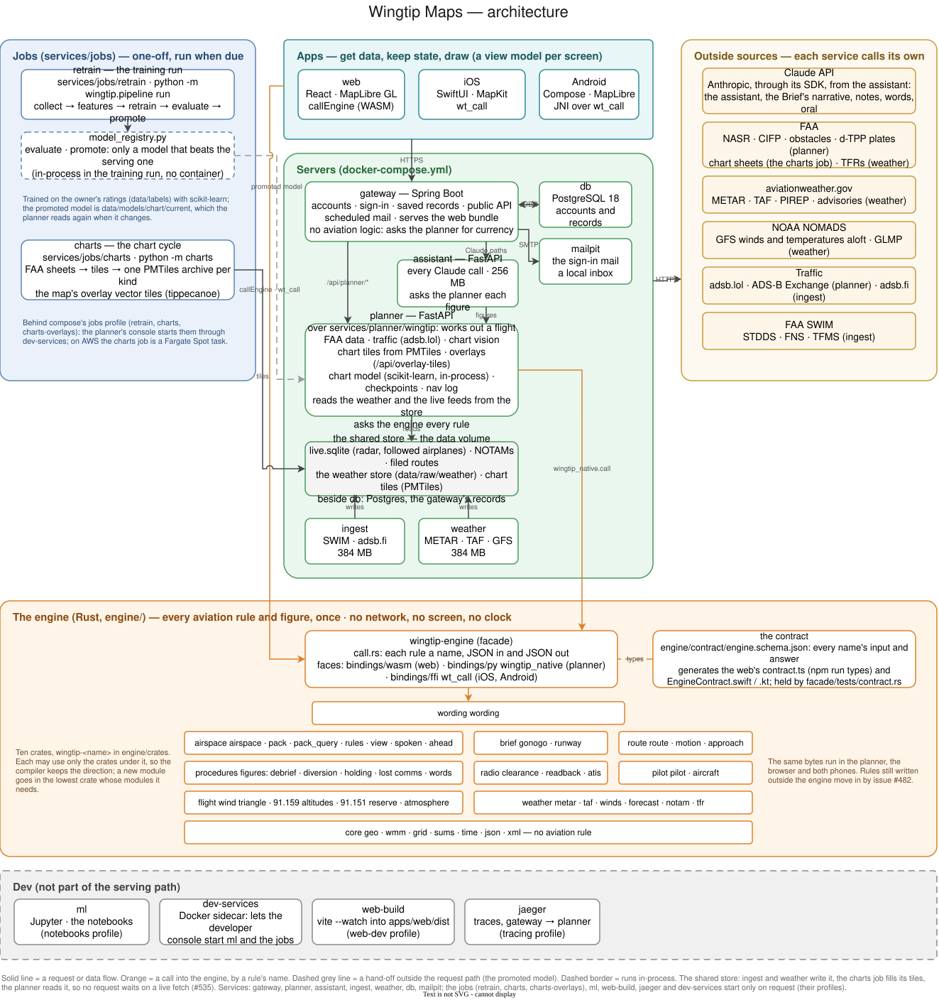

# Architecture

How Wingtip Maps is put together: the four layers, the services that run
them, the stores they share, and where each outside source comes in.
Running it is [LOCAL-DEV.md](LOCAL-DEV.md); the database and the data
folder are [DATA.md](DATA.md); the AWS design is
[README-AWS.md](README-AWS.md).



<sub>Editable source: [`architecture-current.drawio`](architecture-current.drawio).
The SVG carries the diagram too, so it opens in [draw.io](https://app.diagrams.net)
as it is. Re-export it with the `rlespinasse/drawio-export` image after
an edit.</sub>

## Four layers

Functional core, imperative shell: one core every app shares, and a thin
shell per app around it. Each layer has one job, so a rule is written
once and every app gets the same answer.

| Layer | Where | Its job |
|---|---|---|
| **The engine** | [`engine/`](../engine) (Rust) | Every aviation rule and figure, once: altitudes, winds, runways, fuel, weather limits, Go / No-Go, holds, procedures, the clearance reader, the debrief, currency. No network, no screen, no clock. A facade (`wingtip-engine`) over eleven domain crates; each rule is a name in `engine/facade/src/call.rs`, JSON in and out, typed by `engine/contract/engine.schema.json`. [engine/README.md](../engine/README.md) |
| **The planner and its services** | [`services/planner`](../services/planner), [`ingest`](../services/ingest), [`weather`](../services/weather), [`jobs`](../services/jobs) (Python) | Work out a flight. The planner fetches the FAA's data, reads the stores the other services fill, scores checkpoints with the chart model, and asks the engine every rule (`wingtip_native.call`). |
| **The gateway** | [`services/gateway`](../services/gateway) (Spring Boot) | Who the pilot is and what they saved: accounts, sign-in, records, the public API, scheduled mail. No aviation logic: it asks the planner for a figure. [services/gateway/README.md](../services/gateway/README.md) |
| **The apps** | [`apps/web`](../apps/web), [`apps/ios`](../apps/ios), [`apps/android`](../apps/android) | Get data, keep state, draw (one view model per screen), and ask the engine the rest by name: the web through WebAssembly (`callEngine`), the phones through its C interface (`wt_call`). |

The owner kept both server languages on this split (2026-11-06): the
boundary between them is plain HTTP, merging them would give a pilot
nothing, and Spring is good at identity and persistence. Some rules still
live outside the engine, in the Python, the Java and the apps; issue #482
moves them in, in order, and CI's rules boundary (the guards job)
([CI.md](CI.md#rules-boundary)) stops new ones.

## The services

Every service is an entry in [`docker-compose.yml`](../docker-compose.yml).
The long-running ones restart with Docker (`restart: unless-stopped`).

| Service | What it does | Port (this machine only) |
|---|---|---|
| `gateway` | Spring Boot: accounts, sign-in, records, the public API, mail; serves the web app and proxies `/api/planner/*` to the planner | 8080, 8443 (HTTPS) |
| `planner` | FastAPI: the course, checkpoints, nav log, briefing, chart and overlay tiles, traffic, the live SWIM answers and feed health; the engine inside it | 8084 |
| `ingest` | The live feeds, read always: FAA SWIM (STDDS, FNS, TFMS, ITWS, SFDPS) and the followed airplanes' adsb.fi rounds, written into the live store | none |
| `weather` | Fetches the weather on a schedule (METAR, TAF, PIREP, SIGMET, G-AIRMET, GFS winds aloft, GLMP, TFRs, the radar's time) into the weather store | none |
| `db` | PostgreSQL 18 (`postgres:18-trixie`): the gateway's records | not published |
| `mailpit` | The local inbox the sign-in mail goes to (Amazon SES on AWS) | 8025 |
| `dev-services` | A sidecar holding the Docker socket, so the developer console can start `ml` and the jobs | none |

On request only, behind a compose profile:

| Service | Profile | What it does |
|---|---|---|
| `retrain` | `jobs` | The training run (`python -m wingtip.pipeline run`) |
| `charts`, `charts-overlays`, `charts-next` | `jobs` | The chart cycle: the FAA's sheets rendered into one PMTiles archive per kind; the map's overlay vector tiles; the next cycle staged before its date and swapped in at 0901Z on it. [services/jobs/README.md](../services/jobs/README.md) |
| `ml` | `notebooks` | Jupyter on 8888 (token `wingtip`) |
| `web-build` | `web-dev` | `vite build --watch` into `apps/web/dist`, which the gateway serves in place of its own bundle |
| `jaeger` | `tracing` | Traces of a request, gateway to planner to each engine rule and source, on 16686 ([LOCAL-DEV.md](LOCAL-DEV.md#tracing)) |
| `base` | (never runs) | Builds `services/Dockerfile.base`, the Python base with wingtip and the engine that every Python image starts from |

### A request, end to end

```
app (web, iOS, Android)   draws; asks the engine (WebAssembly, wt_call) what it draws
  -> gateway   :8080      serves the page, owns sign-in and records, proxies /api/planner/*
  -> planner   :8084      works out the flight from the stores and the FAA's data; asks the engine every rule
  -> db        :5432      pilots, aircraft, flights, logbook
```

The browser never reaches the planner directly: the gateway checks the
session (and, for the debrief, the subscription), then forwards. Which
planner routes a browser may reach, and what each needs, the gateway
learns from the planner's own OpenAPI document (`x-gateway`).

A request can be followed through all of this as one trace
(OpenTelemetry, to Jaeger, off unless `TRACING=1`;
[LOCAL-DEV.md](LOCAL-DEV.md#tracing)). The page sends an `X-Request-Id`; the
gateway puts it on its span and passes the W3C `traceparent` and the id to
the planner, which takes it up; its spans go down to each engine rule by
its name and each weather product read. Each service
sets this up in one small module of its own (the gateway's `tracing`
package, the planner's `app/tracing.py` over `wingtip/tracing.py`, which the
weather service and ingest start too),
and none of it is loaded where tracing is off.

## The shared stores

No message bus and no HTTP between the planner and the services that
feed it. They share files, so no pilot's request waits on a live fetch and
a restart of the planner drops no feed (issue #535):

- **The live store**, SQLite in WAL mode (`wingtip.stores`): the radar,
  the followed airplanes and their tracks, the NOTAMs, the filed routes,
  and what STDDS, TFMS, ITWS and SFDPS report (RVR, D-ATIS, flow, alerts,
  airspace status). ingest writes it; the planner reads it and writes
  back where the map looks and who is followed. Locally it lives on the
  `live-store` Docker volume, because SQLite's write-ahead log needs
  shared memory that the Mac's file sharing into Docker does not give
  (ingest's writes hung, 2026-11-08). On the server it is on the data disk.
  [services/ingest/README.md](../services/ingest/README.md)
- **The weather store** (`data/raw/weather`, `wingtip.weather_store`):
  the weather service writes it, fast while a pilot is planning and slow
  otherwise; the planner reads it. [services/weather/README.md](../services/weather/README.md)
- **The chart tiles** (`data/raw/chart_tiles.nosync/<cycle>/`): one
  PMTiles archive per chart kind and density (`@2x` for sharp tiles on a
  phone), written by the charts job and served by the planner.

### Feed health

A stopped feed must not read as a quiet sky. The planner holds each feed
to what it normally does (`wingtip.feed_health`, `app/feeds`): STDDS,
TFMS and FNS are stale after 2, 5 and 30 minutes of silence; ITWS and
SFDPS, quiet by nature, only when their connection is down; every feed
when ingest has not beaten for 60 seconds. The weather products are
judged by the weather service's own health check, the FAA's data sets
by their cycles. `GET /api/status/feeds` answers it, and a feed stale
for 15 minutes (`FEED_ALERT_AFTER_MIN`) raises one alert in the log and
to `FEED_ALERT_WEBHOOK` where it is set; the gateway's minute check
(`UptimeWatch`) mails it, beside any service down for 5 minutes, and the
pilot's Status page says which sources have stopped updating.
[OPERATIONS.md](OPERATIONS.md) has every threshold and where alerts go.

## Outside sources

Each service fetches its own; the engine never fetches.

| Source | What | Asked by |
|---|---|---|
| FAA aeronav | Chart sheets (sectional, TAC, IFR low and high), each 56-day cycle | the charts job |
| FAA NASR, CIFP, DOF, d-TPP | Airports, runways, navaids, fixes, airspace (NASR: the National Airspace System Resources data); published procedures (CIFP: the Coded Instrument Flight Procedures); obstacles; plates | planner |
| FAA SWIM | Live feeds over the FAA's System Wide Information Management service: STDDS (terminal radar, RVR, D-ATIS, departures), FNS (NOTAMs), TFMS (flight plans, ground stops and delay programs), ITWS (wind shear and microburst alerts), SFDPS (special activity airspace status) | ingest |
| aviationweather.gov | METAR, TAF, PIREP, SIGMET, G-AIRMET | weather |
| NOAA NOMADS | GFS winds and temperatures aloft, GLMP | weather |
| tfr.faa.gov | TFRs | weather |
| adsb.lol, ADS-B Exchange | The map's traffic, by region | planner |
| adsb.fi | The followed airplanes | ingest |

## Tech stack

- **Engine:** Rust, built for Python (PyO3, `wingtip_native`), WebAssembly
  and a C interface for the phones.
- **Servers:** Python 3.15 with FastAPI; Java 25 with Spring Boot and
  Flyway; PostgreSQL 18; SQLite for the shared stores.
- **Web:** React 19, TypeScript, Vite, TanStack Query, MapLibre GL with
  PMTiles, Vitest and Playwright.
- **Phones:** SwiftUI and MapKit (iOS, watchOS); Kotlin, Jetpack Compose
  and MapLibre (Android).
- **Chart model:** scikit-learn; notebooks in Jupyter.
- **AI:** on the phone only: Apple's Foundation Models on the iPhone and
  Gemini Nano on Android. The server makes no model call
  ([decision 0041](decisions/0041-claude-taken-out.md)); a pilot's own
  Claude or ChatGPT reaches the planner through its MCP connector
  (`services/planner/app/mcp`, [decision 0036](decisions/0036-mcp-connector.md)).
- **Infrastructure:** Docker Compose; GitHub Actions; AWS CloudFormation
  (EC2, CloudFront, S3, Fargate Spot, SES), designed but not yet deployed.

## Where to read next

| For | Read |
|---|---|
| Every endpoint of the planner and the gateway | [api/README.md](api/README.md) |
| wingtip, the planner's Python package | [services/planner/wingtip/README.md](../services/planner/wingtip/README.md) |
| The engine's crates and how a rule is added | [engine/README.md](../engine/README.md) |
| The web app's layout and map | [apps/web/README.md](../apps/web/README.md) |
| The iPhone and Android apps | [NATIVE.md](NATIVE.md), [NATIVE-ANDROID.md](NATIVE-ANDROID.md) |
| Why it is built this way | [LEARNING-GUIDE.md](LEARNING-GUIDE.md) |
