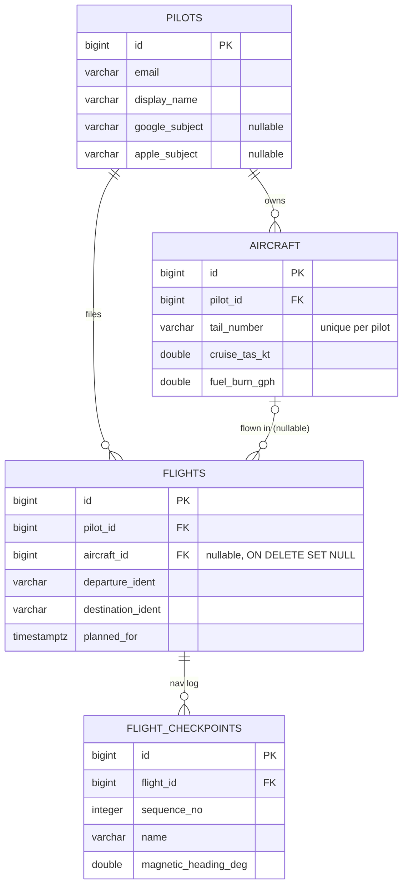

# Data

What Wingtip Maps keeps and where: the gateway's database, the data
folder the Python services share, and the chart model trained on it.
What leaves the device and why is [privacy-inventory.md](privacy-inventory.md).

## The database

The gateway owns the `db` container's Postgres 18 (`postgres:18-trixie`,
volume `pgdata_pg18`). Nothing else writes it. A volume made before
2026-11-09, under the bookworm image (glibc 2.36), has its text indexes
rebuilt and its collation version refreshed once by
`scripts/dev/pg-refresh-collation.sh`, which `go-live.sh` and `dev.sh up`
run; until then Postgres warns of a collation version mismatch on every
connection. Its schema is Flyway's
versioned SQL migrations, not generated from code:

- Add a migration as
  `services/gateway/src/main/resources/db/migration/V<N>__description.sql`;
  it runs on the gateway's next start. Never edit one that has run.
- JPA's `ddl-auto` is `validate`, so an entity that drifts from the schema
  fails the gateway's start (and the Testcontainers test in CI) instead of
  quietly altering a table.

The tables, by what they hold:

| For | Tables |
|---|---|
| The pilot and sign-in | `pilots`, `magic_links`, `SPRING_SESSION`, `SPRING_SESSION_ATTRIBUTES`, `subscriptions`, `paid_feature_uses` |
| Airplanes | `aircraft`, `aircraft_due_items`, `aircraft_squawks` |
| Flights | `flights`, `flight_checkpoints`, `flight_tracks`, `flight_watch`, `reminders_sent` |
| Logbook and training | `logbook_entries`, `pilot_endorsements`, `signed_endorsements`, `instructor_students`, `cross_country_reviews`, `approach_lessons` |
| Measurement | `speed_samples` |

The core of it:



Every record is the pilot's own: each query is scoped to the signed-in
pilot, so an id guessed from another account finds nothing. A flight
keeps its record when its airplane is sold (`aircraft_id` is set null,
not cascaded). Routes and checkpoints are not stored here: the planner
works them out on demand, the same for everyone.

Backups: the owner's Mac dumps it every night ([LOCAL-DEV.md](LOCAL-DEV.md#the-nightly-database-backup));
the server copies it to S3 ([README-AWS.md](README-AWS.md#backups-and-restore)).
CI restores such a dump each night (`scripts/ci/backup_restore.sh`, the
"Backup restores" job): a throwaway Postgres dumped by
`scripts/dev/backup-db.sh` and restored whole into an empty one, its rows
and grants counted, so a dump that cannot be restored is found then.

## The data folder

`data/` at the repository's root, mounted into every Python service at
`/workspace/data`. Git tracks `aircraft/` and one seed file each in
`labels/` (`checkpoint_notes.csv`) and `processed/` (the C81 to KDLH
candidates); the rest is fetched or made and is gitignored. The rest of
`labels/` and `processed/` is the owner's ratings and features, never
committed (CLAUDE.md, "Never"); the two seed files are the one exception,
staged only when changing them is the commit's point.

```
data/
  raw/          what is fetched: the FAA's NASR, CIFP, obstacle and plate files, elevation,
                magnetic variation, the weather store (raw/weather), the chart sheets and
                tiles (charts.nosync/, chart_tiles.nosync/), the cycle packs (raw/packs)
  processed/    feature tables made from it
  labels/       the owner's ratings (chart_picks.csv) and pilots' checkpoint notes
  aircraft/     stock performance profiles (c172.json and others)
  models/       the trained models: candidate/, current/, versions/<time>/, and run.json
```

Never commit anything under `data/labels/` or `data/processed/`: the
owner's ratings and features live there and change locally on purpose.

The live store (radar, NOTAMs, filed routes, the SWIM reports) is not in
`data/` locally but on the `live-store` Docker volume
([ARCHITECTURE.md](ARCHITECTURE.md#the-shared-stores)).

## The chart model

The planner reads checkpoints straight off the sectional: a sectional has
a fixed palette, so water, roads, towns and linework come out of its
tiles in seconds for a 320 nm corridor (`wingtip.chartvision`). The chart
model (`wingtip.chartmodel`, scikit-learn) ranks those detections by how
easily a pilot would spot each one, trained on the owner's ratings made
on the chart itself in the training workspace: 0 to 5, a 0 for a
detection that is no feature at all.

- **Model selection.** Each retrain grid-searches Ridge, Random Forest
  and Gradient Boosting against a predict-the-mean baseline by 5-fold
  cross-validation and keeps the best. A new model is promoted only if it
  beats the one serving on held-out data (`wingtip.model_registry`).
- **Serving.** The planner scores in its own process (`app/chart_scorer.py`)
  from `data/models/chart/current`, and picks up a newly promoted model
  without a restart. scikit-learn is pinned to the training image's.
- **Where it stands.** The first model, on 32 ratings, beats the
  palette's constants on held-out ratings (MAE 1.89 against 2.00) but not
  yet a guess of the mean (1.78). More ratings, the 0s on the reader's
  mistakes most, are what move it; the developer console shows the three
  side by side.
- **A second route.** Every label so far comes from one corridor (C81 to
  KDLH), so nothing yet proves the model transfers. Route position was
  dropped from the features for that reason: alone, it recovered 78% of
  the full model's gain over the mean, which is a route memorised, not
  spottability learned.

An older model, on OpenStreetMap candidates, still trains and is compared
in the console; nothing in the planner asks it. Its first attempt is why
the ratings are made as they are: 77 labels carried over by position,
79% of them a 4 or 5, gave no model that beat the mean (MAE 0.804).

## Notebooks

`docker compose up ml`, then [localhost:8888](http://localhost:8888)
(token `wingtip`). The notebooks call the same code as the training run,
so a notebook and the run cannot write two different tables.

| # | Notebook | What it does | Automated as |
|---|---|---|---|
| 01 | `data_collection` | Candidate checkpoints along the corridor (OSM and FAA NASR) | `pipeline.collect` |
| 02 | `feature_engineering` | The model's feature table | `pipeline.engineer_features` |
| 03 | `sklearn_baseline` | Ridge, Random Forest and Gradient Boosting, nested cross-validation, permutation importance | `pipeline.retrain` |
| 08 | `altitude_selection` | The cruise altitude step by step: terrain and obstacles, Class B, C and D, weather, the ceiling, checked against the planner's answer | `wingtip.altitude` |

Numbers 04 to 07 are unused: they compared PyTorch, Keras,
sentence-transformers and Spark MLlib, and went on 2026-11-06, since only
scikit-learn reaches a pilot.
