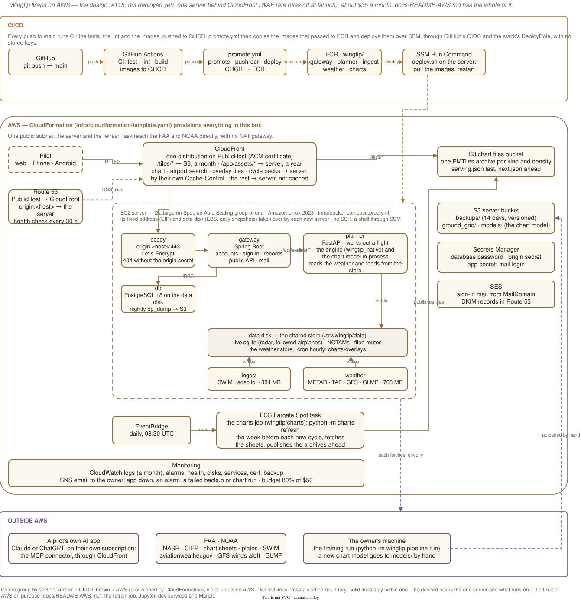

# Wingtip Maps on AWS

## Contents

- **[The design](#the-design)** — [What runs where](#what-runs-where) · [What is left out](#what-is-left-out)
- **[What it costs](#what-it-costs)**
- **[Rehearse it locally](#rehearse-it-locally)**
- **[The first deploy](#the-first-deploy)** — [Before anything (the owner)](#before-anything-the-owner) · [The stack](#the-stack) · [The images and the server](#the-images-and-the-server) · [Mail](#mail) · [The first chart cycle](#the-first-chart-cycle) · [The chart model](#the-chart-model)
- **[Running it](#running-it)** — [Deploys](#deploys) · [On the server](#on-the-server) · [Chart cycles](#chart-cycles) · [Backups and restore](#backups-and-restore) · [A new server](#a-new-server) · [Teardown](#teardown)
- **[Gotchas](#gotchas)**

## The design

The app runs on one small server behind CloudFront. What is the same for
every pilot is drawn ahead of time and served from the edge.

**Status:** written and checked, not deployed. The template passes
`cfn-lint`, every image builds, and the server's files are checked in CI
(the `infra` job); what remains is the owner's AWS account and domain,
then `aws cloudformation deploy` ([The first deploy](#the-first-deploy),
issue #115).



The expensive parts of the old design, an ALB, RDS, a NAT gateway, VPC
endpoints and Fargate services running all month, cost about $200–250
a month for a planner nobody was using yet. This design costs a fifth of
that (below), and the map is faster: tiles come from the nearest
CloudFront edge, kept there from the planner reading them out of a
pyramid drawn ahead of time, not drawing them on request.

### What runs where

```
pilot ──HTTPS──▶ CloudFront  (app.example.com, ACM certificate)
                   │
                   ├─ /tiles/*        ──▶ S3 tiles bucket       serving.json and the archives, read by the planner
                   ├─ /api/planner/chart-tile/*, terrain-tile/*, overlay-tiles*
                   │                  ──▶ the server's planner  a tile out of its archive, cached a year (cycle, revision in the address),
                   │                                            Caddy straight to the planner, not through the gateway
                   ├─ /app/assets/*   ──▶ the server            cached a year (fingerprinted), Brotli where asked
                   ├─ the chart, the airport search, the stock aircraft
                   │                  ──▶ the server            cached by their own header: a minute, an hour
                   └─ everything else ──▶ the server            not cached: pages, /api, sign-in
                                            │ origin.app.example.com:443, with X-Origin-Secret
                                            ▼
                        EC2 t3a.large on Spot, a group of one (Amazon Linux 2023,
                        infra/docker-compose.prod.yml), its fixed address and data disk
                        taken over by whichever server is running
                          caddy ─▶ gateway ─▶ planner (the chart model and the engine in-process)
                            └──▶ planner, the map's tiles alone (chart, terrain, overlays)
                                     └──▶ db (Postgres 18, on the data disk)
                          ingest (the FAA's SWIM feeds, the followed airplanes, 384 MB) ─▶ SQLite
                          weather (METARs, TAFs, advisories, the GFS's winds, GLMP, TFRs, 768 MB)
                                     ─▶ the weather store; both on the data disk, which the planner reads
                          nightly pg_dump ─▶ S3 server bucket (14 days)

EventBridge, daily 08:30 UTC ─▶ Fargate Spot task: the charts job (services/jobs/charts), refresh
   in the week before each new cycle, once the FAA has it up, fetches
   every sheet, draws the pyramid (1.5 million tiles), packs each kind
   into one PMTiles archive per density and publishes them to the tiles
   bucket ahead, next.json last, which every planner takes at 0901Z on
   the cycle's date; the next run makes it serving.json's
server cron, hourly ─▶ docker compose run --rm charts-overlays
   the map's overlay tiles, built where the planner's new cycle pack has none
```

- **One domain for everything** (`PublicHost`), so the gateway's Secure
  session cookies work as they do locally and the map's tile requests
  are same-origin.
- **What the edge keeps is what is the same for every pilot.** Besides
  the tiles and the app's files, three answers: the chart the map draws
  (a minute), the airport search as a pilot types, and the stock
  aircraft (an hour each). Each says so itself (`app.router_basics` in the
  planner), the gateway passes the header on for the routes the planner
  marks `SHARED` alone (`app.gateway`, read by the gateway's
  `UpstreamRoutes`), and CloudFront keys them by path and query
  string, never by cookie. Everything with weather in it (the fields in
  view, an airport's card, the Class B list, the airspace at a point), a
  route's answers, and anything of one pilot's is `no-store`, which
  `CacheHeadersTest` checks through the whole filter chain.
- **The map's tiles skip the gateway.** The chart's tiles, the
  terrain's and the overlays' archive are public and the same for every
  pilot, so Caddy hands those addresses, written out whole and read by
  GET alone, to the planner itself (`infra/server/Caddyfile`, `@tiles`),
  with the viewer's cookies and any `X-Pilot-Id` dropped: no Spring
  filter chain, no session or CSRF cookie, no page headers, one hop less
  for each of a screenful of tiles. Nothing else of the planner's is
  reached that way (`tests_wingtip/test_front_door.py`). CloudFront keeps
  them as long as the planner says, a year for a tile whose address
  names its cycle and revision (`TilesCachePolicy`, keyed on `c` and `r`
  alone). In the development stack, which has no Caddy, the gateway
  still forwards them, without the page's headers (`TileSecurityConfig`).
- **A rate limit on the tiles the server answers.** A tile's address
  with a `?c=` or `?r=` of its own is a cache miss, which the planner
  reads on the server. The `TileRateLimit` web ACL (AWS WAF, on the
  distribution) answers 429 to an address past 3,000 requests to
  `/api/planner/chart-tile/` and `/api/planner/terrain-tile/` in five
  minutes, ten a second held; a pilot's session is some 200 tiles. A
  second rule in it does the same for every other `/api/planner/` path
  (a plan, a nav log, the FAA's PDFs, the overlay tiles), counted apart
  from the tiles (the round 4 security review's M4). The rest of the
  site is not limited by it. WAF's CloudFront scope
  exists only in us-east-1, where the stack is deployed. Its cost is in
  the table below; to raise or lower the limit, change its `Limit`.
- **Only CloudFront reaches the server.** The security group admits
  port 443 from CloudFront's origin-facing addresses alone, and Caddy
  answers 404 to any request without the secret header CloudFront adds
  (`infra/server/Caddyfile`). Port 80 is open for Let's Encrypt, which
  gives Caddy the certificate for `origin.<domain>`.
- **No SSH.** A shell on the server is SSM Session Manager; deploys are
  SSM Run Command. The server's role can pull its own images, read its
  own secrets and write its own backups, and nothing else.
- **The gateway changes rows, never the schema.** Flyway signs in as the
  database's owner (`DbPasswordSecret`, `POSTGRES_PASSWORD`); the app
  signs in as `wingtip_app` with a secret of its own
  (`AppDbPasswordSecret`, `APP_DB_PASSWORD`), which may read and write
  the rows of every table and nothing more: no CREATE, ALTER, DROP or
  TRUNCATE. Flyway's `db/callback/afterMigrate.sql` makes the role and
  sets its password at each start, so a fresh database, an old one and
  a restored backup all end the same, and a rotated secret takes at the
  next deploy (docs/SECURITY.md, N4).
- **The planner no longer draws tiles** (`CHARTS_AUTO_REFRESH=0`,
  `CHART_TILES_URL`): it reads each one out of the published archive by
  a range request through CloudFront (`wingtip.tile_archive`, the
  archive's header and directory read once and kept), and CloudFront
  keeps what it answers. It still reads the chart for checkpoints, from
  the sheets under each route, fetched the first time a route needs them
  and kept on the server's disk.
- **The planner keeps the FAA's data current** (`FAA_DATA_AUTO_REFRESH`,
  on): four times a day it looks for a new edition of the NASR files
  (airports, frequencies, navaids, Class B/C/D, every 28 days) and the
  obstacle file (every 56), and reads a new one in place. Its own
  switch, so the charts being off does not leave it reading an old
  cycle; `0` turns it off.
- **The server is Spot capacity, and replaceable.** It runs at about a
  third of the on-demand price, in an Auto Scaling group of one. When
  AWS takes it back (a few times a year) or it fails its checks, the
  group starts another, of either of two types for more spare capacity;
  the new server takes over the fixed address and the data disk, which
  holds everything it keeps, and is serving again within minutes, its
  database as the last one left it. `ServerPricing=on-demand` makes it
  a server AWS never takes back, the same way.
- **Images are x86** (t3a), so CI's images run as built. A Graviton
  server (t4g) would save about $3 a month and need every image built
  for both architectures.

Every resource is in [`infra/cloudformation/template.yaml`](../infra/cloudformation/template.yaml);
the server's own files are in [`infra/server/`](../infra/server/) and
[`infra/docker-compose.prod.yml`](../infra/docker-compose.prod.yml).

### What is left out

Each of these stays in the development stack (`docker-compose.yml`), and
nothing in production calls it; the developer console says so where it
offers one.

| Left out | Why | In production |
|---|---|---|
| The pipelines and the training run | Retraining runs on the owner's machine (`python -m wingtip.pipeline run`) | The console's retrain button says there is no sidecar to start it, and gives the command; a new model is uploaded (below) |
| Mailpit | A development mailer | Sign-in mail goes through Amazon SES |
| dev-services, Jupyter | Development tools | The console's service buttons say there is no sidecar |

## What it costs

Prices in us-east-1, October 2026, at today's traffic:

| Item | A month |
|---|---|
| EC2 t3a.large on Spot, all month (on demand: about $55) | ~$19, as Spot's price moves |
| Its public IPv4 address | $3.65 |
| 20 GB system disk and 30 GB data disk, gp3 | $4.00 |
| S3 tiles: a few dozen archives a cycle (cents; they were 2.2 million tile uploads, about $11), and up to three cycles stored (some 36 GB a cycle with the @2x tiles) | ~$2.50 |
| Secrets Manager, four secrets | $1.60 |
| Route 53 hosted zone | $0.50 |
| Daily snapshots of the data disk, seven kept | ~$1 |
| The health check (HTTPS, every 30 s), the server's logs in CloudWatch, and its eight alarms and seven figures (`health.sh`, the gateway's alerts; within CloudWatch's free ten of each) | ~$1.60 |
| ECR, CloudWatch logs, backups, the Fargate Spot refresh (under $1 a cycle) | ~$1.50 |
| CloudFront | $0 within the always-free 1 TB and 10 million requests |
| AWS WAF, the planner's two rate rules (`TileRateLimit`): $5 the web ACL, $1 each rule, $0.60 a million requests it sees (every request to the distribution, about 0.3 million) | ~$7.20 |
| SES | $0.10 per 1,000 sign-in emails |
| **Total** | **about $42** |

With `ServerPricing=on-demand`, for a server AWS never takes back, it
is about $78, or about $52 with a one-year Savings Plan. The template's
default is a t3a.large (8 GB) since 2026-11-21 (the owner, on the
prelaunch audit): the services take about 3.5 GB, which a t3a.medium's
4 GB barely holds. `InstanceType=t3a.medium` (and `SpareInstanceType=t3.medium`)
still deploys the smaller server, at about $33. On the large one each service is
held to its share (infra/docker-compose.prod.yml): the planner 3 GB, the
gateway 1.5 GB, Postgres 1 GB, weather 768 MB, ingest 384 MB, the shares
the after-merge campaign's stress run is held to. The next
saving after Spot was the tiles' upload bill, and the archives (#535)
took it to cents, the reader in the planner rather than the map.

The template's `BudgetEmail` sets an alarm at 80% of $50 a month.

### As pilots come

Recomputed on 2026-11-21 (the prelaunch audit) from today's archives and
AWS's public us-east-1 prices (CloudFront pay-as-you-go: 1 TB and 10
million requests a month always free, then $0.085 a GB and $0.01 per
10,000 HTTPS requests; EC2 on-demand, Spot taken at about a third). One
cycle's archives are about 30 GB (sec@2x 18 GB, sec 6.7, tac@2x 2.3, tac
0.9, IFR 1.8, the overlays 0.12), PNG tiles of 35 KB on average at @2x;
packed as lossless WebP from 2026-11-21 (services/jobs/README.md, "The
chart tiles as archives") about 89% of that, some 27 GB a cycle.
An active pilot is taken as ten sessions a month of about 200 tiles and
100 answers each, some 80 MB and 3,000 requests (the web's service
worker keeps 20,000 tiles for the cycle, so a pilot's own area costs
little the second time). The planner's CPU per route and its memory
were not measured for this; the server's services add up to about
3.5 GB (weather 768 MB, ingest 384 MB, the gateway's JVM, the planner,
Postgres), which a t3a.medium's 4 GB barely holds, so a t3a.large is
the launch size, and the template's default.

| A month | 100 pilots | 1,000 pilots | 10,000 pilots |
|---|---|---|---|
| The server, Spot (on demand) | t3a.large ~$19 ($55) | t3a.large ~$19 ($55) | t3a.xlarge ~$40 ($110) |
| IPv4 address, disks, snapshots | ~$9 | ~$9 | ~$12 (an 80 GB data disk) |
| S3, three cycles of archives (~90 GB) | ~$2.10 | ~$2.10 | ~$2.10 |
| CloudFront (data, requests) | $0 (8 GB, 0.3 M) | $0 (80 GB, 3 M) | ~$20 (800 GB free, 30 M requests) |
| SES, Secrets Manager, Route 53, logs, ECR, the cycle's Fargate task | ~$5 | ~$5 | ~$9 |
| AWS WAF, the planner's two rate rules ($7, and $0.60 a million requests) | ~$7.20 | ~$8.80 | ~$25 |
| **Total, Spot (on demand)** | **~$42 ($78)** | **~$44 ($80)** | **~$108 ($178)** |
| Per pilot | $0.42 | $0.044 | $0.011 |

The server is the cost until some 10,000 pilots; the CDN's bill is its
requests, not its bytes, and the always-free terabyte holds about 12,000
pilots' tiles. ADS-B Exchange's RapidAPI plan (10,000 requests a month)
is not in the table: past a few thousand pilots its fallback needs a
bigger plan or to be left to adsb.lol.

## Rehearse it locally

[`infra/rehearsal/run.sh`](../infra/rehearsal/run.sh) runs the production stack on this machine before anything goes to AWS. It is
`infra/docker-compose.prod.yml` as the server runs it: the two images built
from this checkout, no source mounted, and Caddy demanding CloudFront's
secret header. Stand-ins replace what only AWS has:

- **CloudFront** is a Caddy (`cdn`) on https://localhost:9443. It serves
  `/tiles/*` from a local tile cache laid out as the S3 bucket is
  (serving.json and the archives), and sends everything else to the
  origin with the secret header.
- **SES** is a Mailpit on http://localhost:9025, where the sign-in links
  arrive.
- **The data disk** is a folder of its own, empty at first, so the
  planner fetches its FAA data as a new server does: about four minutes
  before it is warm. The first nav log in an area takes longer still,
  while its terrain downloads.

```bash
docker compose stop        # the development stack: both do not fit in Docker's 6 GB
infra/rehearsal/run.sh     # TILES_DIR=<a chart pyramid> if this checkout has none
```

Then the browser suite runs against it as it runs against the
development stack, on the rehearsal's own network with Caddy's local
certificate accepted (`ignoreHTTPSErrors`):

```bash
docker run --rm --network wingtip-prod_default -v "$PWD/apps/web:/w" -w /w \
  -e BASE_URL=https://cdn:9443 -e MAILPIT_URL=http://mailpit:8025 \
  mcr.microsoft.com/playwright:v1.65.0-noble \
  npx playwright test --config playwright.rehearsal.config.ts --workers=2
```

The gateway's two roles are checked here as on the server: the app's
role reads rows and may not touch the schema.

```bash
docker compose -p wingtip-prod exec -T db psql -U wingtip -d wingtip -Atc \
  "SELECT has_table_privilege('wingtip_app', 'pilots', 'DELETE'),
          has_table_privilege('wingtip_app', 'pilots', 'TRUNCATE'),
          has_schema_privilege('wingtip_app', 'public', 'CREATE'),
          (SELECT count(*) FROM pg_tables WHERE schemaname = 'public' AND tableowner = 'wingtip_app')"
# t|f|f|0
```

Not rehearsed here, since they need AWS itself: `deploy.sh`,
`backup.sh` and `health.sh` (`DRY_RUN=1` prints its figures), CloudFront's caching, the Spot group and its data disk,
and the chart refresh's publish to S3 (its bucket check has a test).

## The first deploy

### Before anything (the owner)

What only the owner can do (issue #115):

1. An AWS account, with MFA on the root user.
2. A domain whose DNS is a Route 53 hosted zone in that account. Note
   the zone's ID.
3. The AWS CLI on the Mac, signed in to that account (`aws configure` or
   `aws sso login`), and the
   [Session Manager plugin](https://docs.aws.amazon.com/systems-manager/latest/userguide/session-manager-working-with-install-plugin.html)
   for a shell on the server.
4. Only with the map's Google overlay: a Google Maps key restricted to
   the Map Tiles API alone and to the site's referrer
   (`https://<the domain>/*`), with daily quotas and a budget alert
   (docs/GOOGLE-MAPS.md, "What only the owner can do"). The app hands the
   key to every browser; those restrictions are all that keep it to this
   site.

### The stack

The server's image is named, not looked up, so that a later stack update
never replaces the server because Amazon published a newer one. Find the
current one, then create the stack (us-east-1 only: CloudFront's
certificate must be there):

```bash
AMI=$(aws ssm get-parameter --region us-east-1 \
  --name /aws/service/ami-amazon-linux-latest/al2023-ami-kernel-default-x86_64 \
  --query Parameter.Value --output text)

aws cloudformation deploy --region us-east-1 --stack-name wingtip \
  --template-file infra/cloudformation/template.yaml \
  --capabilities CAPABILITY_IAM \
  --parameter-overrides \
    PublicHost=app.example.com HostedZoneId=Z0123456789ABC \
    ServerImageId="$AMI" BudgetEmail=you@example.com

aws cloudformation describe-stacks --region us-east-1 --stack-name wingtip \
  --query 'Stacks[0].Outputs' --output table
```

It takes about 20 minutes, most of it the certificate's DNS validation
and CloudFront. Pass `CreateGitHubOidcProvider=false` if the account
already trusts GitHub's OIDC provider. `MailDomain` sends sign-in mail
from another domain than `PublicHost`.

The outputs name everything the steps below need.

### The images and the server

The server boots, installs Docker, clones this repository and writes
its settings, but has no images to run until the first push to ECR.

1. In GitHub, Settings → Secrets and variables → Actions → Variables,
   add `AWS_ROLE_ARN` (the `DeployRoleArn` output), `AWS_REGION`
   (`us-east-1`) and `AWS_SERVER_NAME` (the `ServerName` output).
2. In GitHub, Settings → Environments, create `production` and under
   "Deployment branches and tags" choose "Selected branches and tags"
   with `main` alone. The deploy role trusts only a job in this
   environment (`sub` `repo:<owner>/<repo>:environment:production`), not
   any workflow on `main`: ci-autofix.yml runs as `main` while it runs a
   branch's code. Without the branch rule a
   workflow on any branch could name the environment and get the role;
   a job that names an environment that does not exist creates it with
   no rules at all, so create it first.
3. Fill in the owner's values in the `AppSecret` output's secret, as
   [`infra/server/env.example`](../infra/server/env.example) lists them:

   ```bash
   aws secretsmanager put-secret-value --region us-east-1 \
     --secret-id <AppSecretArn> --secret-string file://app-secret.json
   rm app-secret.json
   ```

4. The next green CI run on `main` promotes its images, copies the two
   the server runs from GHCR to ECR as `sha-<commit>` and `latest`
   (`promote.yml`, `push-ecr`: the images CI tested, not rebuilt) and runs
   [`infra/server/deploy.sh`](../infra/server/deploy.sh) on the server
   (`deploy`). To deploy without waiting for one:

   ```bash
   aws ssm send-command --region us-east-1 --targets Key=tag:Name,Values=<ServerName> \
     --document-name AWS-RunShellScript \
     --parameters 'commands=["/srv/wingtip/repo/infra/server/deploy.sh"]'
   ```

`deploy.sh` writes the server's `.env` from the stack's settings and the
four secrets, pulls the images and starts what changed. It is safe to run
at any time.

### Mail

The stack creates the SES identity for the mail domain and its three
DKIM records. Then:

1. **SMTP credentials:** SES console → SMTP settings → Create SMTP
   credentials. The user name and password go in the `AppSecret` as
   `MAIL_USERNAME` and `MAIL_PASSWORD`; run `deploy.sh` again.
2. **DMARC:** add a TXT record `_dmarc.<mail domain>` with
   `v=DMARC1; p=quarantine; rua=mailto:<you>`. DKIM, signed by SES for
   the domain, is what aligns for DMARC.
3. **SPF** is SES's own: it sends from `amazonses.com` unless a custom
   MAIL FROM domain is set up, so the domain needs no SPF record for
   these emails.
4. **Leave the sandbox:** SES console → Account dashboard → Request
   production access. Until Amazon approves it, mail goes only to
   addresses verified in SES, which is enough to test with your own.

### The first chart cycle

The daily refresh draws the cycle at 08:30 UTC. To have tiles now, run
the `ChartRefreshNow` output's command. The whole country takes some
hours on the task's two cores; its log is in CloudWatch under
`/ecs/wingtip-chart-refresh`. Until it publishes, the map has no chart
under it.

### The chart model

The planner ranks checkpoints with the chart model when one is there,
and by its own rules when not. It is trained on the Mac, by the
development console's Retrain or by hand:

```bash
docker compose run --rm retrain
```

which promotes it into `data/models/chart/current` only if it beats the
one there on the held-out ratings. To serve it:

```bash
aws s3 sync data/models/chart/current s3://<ServerBucketName>/models/chart/current/
```

then run `deploy.sh`, which copies it to the server. Each retrain on the
Mac is promoted the same way.

## Running it

### Deploys

A pull request merged to `main` deploys itself once CI passes: Promote
copies the images CI tested to ECR and runs `deploy.sh <commit>` over
SSM, and the job fails if it does. The server checks out that commit,
for `infra/docker-compose.prod.yml` and the Caddyfile, and runs its images
(`IMAGE_TAG=sha-<commit>`), so files and images always match whatever
has merged since. A deploy restarts only the services whose image
changed. `deploy.sh` with no commit, by hand, takes `main` and `latest`.
To go back to an earlier commit, run `deploy.sh <its full hash>`: ECR
keeps the last 20 images of each service.

### On the server

```bash
SERVER=$(aws ec2 describe-instances --region us-east-1 \
  --filters Name=tag:Name,Values=<ServerName> Name=instance-state-name,Values=running \
  --query 'Reservations[0].Instances[0].InstanceId' --output text)
aws ssm start-session --region us-east-1 --target "$SERVER"
sudo -i
cd /srv/wingtip/repo
docker compose --env-file /srv/wingtip/.env -f infra/docker-compose.prod.yml ps
docker compose --env-file /srv/wingtip/.env -f infra/docker-compose.prod.yml logs -f --tail 100 gateway
```

`/srv/wingtip` is the data disk: `data` the data folder the planner shares
with ingest and weather,
`postgres` the database, `repo` this repository. Never edit
`/srv/wingtip/.env`; `deploy.sh` writes it.

### When something goes wrong

- **The app down:** Route 53 asks `https://<domain>/actuator/health`
  every 30 seconds from round the world, through CloudFront, and three
  minutes without an answer emails `BudgetEmail` (confirm the SNS
  subscription mail once); another follows when it is back. A Spot
  interruption's few minutes may send one pair.
- **A failed backup** emails the same address (`backup.sh`), and so does
  a night with no backup at all (`BackupLateAlarm`).
- **The server's own checks** (`infra/server/health.sh`, every five
  minutes from cron) send CloudWatch both disks' use, the services not
  running or unhealthy (and restart an unhealthy one, which Docker's
  restart policy never does), the origin certificate's days left and the
  last backup's age; the stack's alarms on them email the same address,
  as do the chart refresh task stopping without finishing, ACM's
  certificate warnings and every `ALERT` line of the gateway's monitor
  (counted from its log, so they arrive when SES is what has failed).
  [RUNBOOKS.md](RUNBOOKS.md) has each alert and what to do.
- **The logs:** every service's, in CloudWatch under `/<stack>/server`,
  a stream per container, kept a month, one JSON object a line with the
  page's request id (the gateway's `requestId`, the planner's
  `request_id`), which Logs Insights queries by field
  ([RUNBOOKS.md](RUNBOOKS.md), "Reading the logs"):

  ```bash
  aws logs tail /wingtip/server --region us-east-1 --follow --log-stream-name-prefix wingtip-gateway
  ```

- **Faults on pilots' devices** (the web's uncaught errors, the iPhone's
  MetricKit diagnostics, Android's exit reasons and crashes) are kept 30
  days in the `diagnostics` table, read by the developer at `GET
  /api/diagnostics`, and logged in the gateway's stream as `web|ios|android
  <version> [<kind>] ...` lines (`DiagnosticsController`): the signature
  and the scrubbed stack, nothing of the pilot's.
- **A service down or a feed stale** is mailed to `APP_ALERT_EMAILS` (the
  developers where unset) by the gateway's minute check, and logged as
  `ALERT` and `RECOVERED` lines in its stream: what is watched, and after
  how long, is in [OPERATIONS.md](OPERATIONS.md).

### Chart cycles

Nothing to do. In the week before a new cycle's date (the charts'
`CHARTS_CYCLE_LEAD_DAYS`, 7), once the FAA has put it up, the daily task
draws and publishes it ahead of its date under `next.json`; every planner
takes it at 0901Z on the date, when it comes into force (14 CFR 91.103),
and the next day's run makes it `serving.json`'s, keeping the one it
replaced as `serving-previous.json`. On the other days a run is a read or
two. Until 2026-11-21 the task drew a cycle only from its date, so the map
served the expired one for the hours that took, every cycle. A run that
fails or that Spot takes back is mailed (`ChartRefreshFailedRule`) and tried
again the next day, with six days in hand; a bad cycle is undone by
copying `serving-previous.json` back ([RUNBOOKS.md](RUNBOOKS.md), "A bad or
late FAA cycle"). The server lets an older cycle's chart sheets go by
itself (`chart_upkeep.prune_behind_served`). Tiles are cached by their cycle,
so a tile drawn again within a cycle (a renderer change) reaches pilots
with the next cycle.

### Backups and restore

At 07:17 UTC every night `backup.sh` copies to
`s3://<ServerBucketName>/backups/<date>/` what the server alone holds:
the database (`postgres.dump`: accounts, aircraft, flights), each table's
rows and the schema's version (`manifest.txt`, which a restore is checked
against) and the planner's `data/labels` (`labels.tar.gz`: the
checkpoint notes pilots have written). The bucket keeps 14
days, and is versioned: a backup overwritten or deleted stays as an
older version for 30 days more (`aws s3api list-object-versions`). The
server may write only `backups/` and `ground_grid/`. The dump is written to a file and checked with `pg_restore --list`
before it is uploaded, so a truncated one never replaces a good day, and a
failed backup emails `BudgetEmail` (confirm the SNS subscription mail once).
The data disk is also snapshotted daily at 05:00 UTC, seven kept.
[RUNBOOKS.md](RUNBOOKS.md), "Restore a backup", is the restore step by
step, and its drill (`scripts/dev/restore-drill.sh`) restores a night into
a scratch Postgres, checks it against its manifest and starts the gateway
on it; run it monthly. In short, on the server:

```bash
cd /srv/wingtip/repo
infra/server/restore-deletions.sh save
B=s3://<ServerBucketName>/backups/<date>
aws s3 cp $B/postgres.dump - | \
  docker compose --env-file /srv/wingtip/.env -f infra/docker-compose.prod.yml \
  exec -T db pg_restore -U wingtip -d wingtip --clean --if-exists
aws s3 cp $B/labels.tar.gz - | tar -xz -C /srv/wingtip/data
infra/server/restore-deletions.sh apply
docker compose --env-file /srv/wingtip/.env -f infra/docker-compose.prod.yml restart gateway planner
```

**A deleted account stays deleted.** A dump from before a pilot deleted
their account holds that account. The gateway notes each deletion by the
pilot's id alone in `deleted_accounts` (V47, kept 60 days, longer than any
backup), and `backup.sh` copies that list to `backups/deleted-accounts.csv`
each night. `restore-deletions.sh save` keeps the live database's list (if
it still answers) and the nightly copy before the restore; `apply` puts
them back and moves the pilots' id sequence past them. As the gateway
starts it deletes again every noted account the restore brought back,
the planner's notes included (`DeletionsReapplied`), and it looks again
each night. Restoring a snapshot of the data disk is the same: `save`
before the new volume is attached (the nightly copy, if the old disk is
gone), `apply` once the stack is up. Only an account deleted after the last
night's copy, on a server whose database is lost, is not caught: the dump
it comes back from is at most a day older than that deletion, and the pilot
deletes it again (docs/privacy-inventory.md says so).

Everything else in the data folder (the FAA's files, the chart sheets)
is downloaded again by the planner as it is needed.

### A new server

A Spot interruption, a failed health check, a new `ServerImageId` or a
change of `ServerPricing` all end the same way: the group stops the old
server and starts another, which takes over the address and the data
disk on its first boot, pulls the images and starts the stack -- a few
minutes without the app, and nothing lost. Nothing to do by hand.

Only a lost data disk means restoring: from its newest daily snapshot
(EC2 → Snapshots, create a volume in the same zone, then update the
stack's `DataVolume`), or from the nightly dump as above.

### Teardown

```bash
aws cloudformation delete-stack --region us-east-1 --stack-name wingtip
```

Empty the tiles bucket first (or the delete fails on it). The server
bucket, with the backups, is kept on purpose, and the data disk leaves
a final snapshot: delete them by hand when they are no longer wanted.

## Gotchas

- **The CloudFront prefix list counts as 55 rules** against the
  security group's limit of 60.
- **Caddy needs `origin.<domain>` to resolve** before it can get its
  certificate; it retries by itself after the first boot, while the
  record is being created.
- **The Fargate task has no data folder mounted:** the planner image
  makes `/workspace/data` its user's for that, and the task's 60 GB of
  storage holds the sheets and the pyramid.
- **The refresh task's empty disk would read as a cycle never drawn;**
  it asks the bucket's `serving.json` first (`wingtip.chart_upkeep.refresh`),
  then `next.json`, the cycle staged ahead.
- **A new server waits for the data disk.** Its first boot attaches the
  disk only once the last server has let it go, so a replacement that
  starts before the old server has stopped waits, then carries on.
- **`AppSecret` is written once.** The stack leaves the values filled in
  by the owner alone unless its `SecretString` in the template changes,
  so leave that as it is.

---

Back to [`README.md`](README.md) for the project overview.
