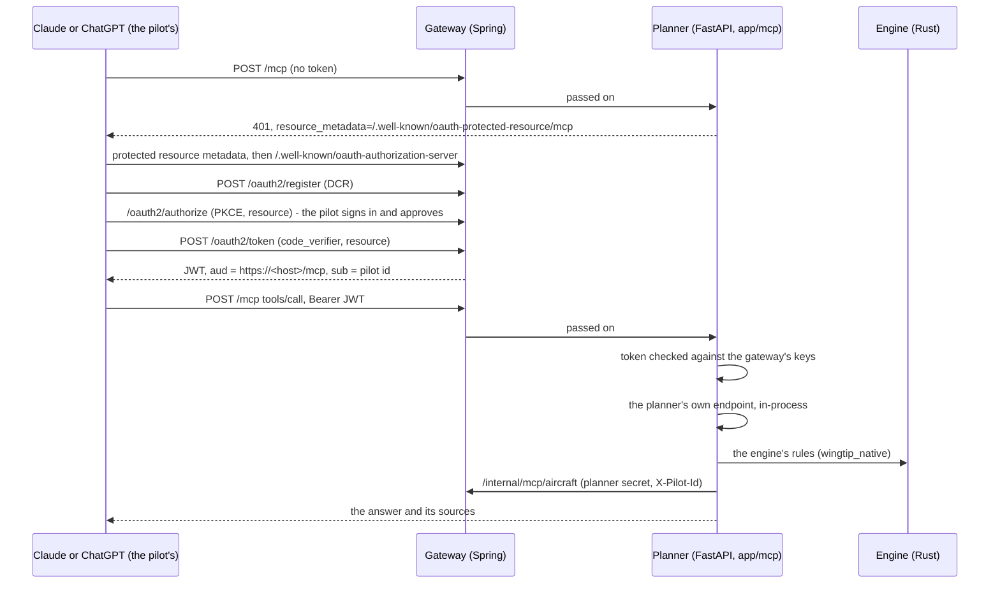

# The Wingtip connector: Wingtip in a pilot's own Claude or ChatGPT

The owner, 2026-11-10: server-side Claude stays off until there is a
subscription (decision 0035); on 2026-11-12 it was taken out altogether
(decision 0041). Instead, Wingtip is published as an MCP
**connector** that a pilot adds to the Claude or ChatGPT they already pay for.
Their subscription pays for the model; Wingtip only answers tool calls, from
the engine and the planner, for the pilot signed in with their Wingtip
account, so the tools know their airplanes and flights. Decision 0036 records
it.

This page says what was checked and where (section 1), how it is built
(2 to 6), and what is left for the owner (7). The developer's how-to, which
connects a local stack to Claude or ChatGPT, is
[docs/MCP-CONNECTOR.md](../MCP-CONNECTOR.md).

## 1. What was checked, and where

Every fact below was read on 2026-11-10 from the page linked. Where a page
could not be read, it says so.

### The MCP specification

[Authorization, version 2026-07-28](https://modelcontextprotocol.io/specification/latest/basic/authorization)
(the `latest` link resolved to it):

- The MCP server is an OAuth 2.1 resource server. It **must** serve
  Protected Resource Metadata (RFC 9728) and answer an unauthenticated
  request with `401` and `WWW-Authenticate: Bearer resource_metadata="..."`,
  with a `scope` parameter recommended.
- The authorization server **must** offer RFC 8414 metadata or OpenID
  Connect Discovery.
- Client registration: Client ID Metadata Documents are a **should**;
  Dynamic Client Registration (RFC 7591) is a **may**, and is now marked
  deprecated, kept for servers without CIMD. Pre-registration is the third way.
- PKCE with S256 is required of the client, and the resource indicator
  (RFC 8707, the MCP server's canonical URI) goes in both the authorization
  and the token request.
- The MCP server **must** check that a token was issued for it (its
  audience) and **must not** accept or pass on any other token. Invalid or
  expired tokens get a `401`; a missing scope gets a `403` with
  `error="insufficient_scope"`.
- The `iss` parameter in the authorization response (RFC 9207) is a
  **should** for the authorization server, expected to become a **must**.

### Claude

- [Add a connector that isn't in the directory](https://claude.com/docs/connectors/custom/remote-mcp):
  a custom connector by URL works on the **Free (one connector), Pro, Max,
  Ultra, Team and Enterprise** plans, on the web, desktop and mobile apps; on
  Team and Enterprise an Owner adds it and members connect with their own
  account. The transport is Streamable HTTP (a URL ending in `/sse` picks the
  older SSE). The dialog's OAuth client choices are Claude's published
  identity (CIMD), automatic registration (DCR), or a client ID entered by hand.
- [Authentication for connectors](https://claude.com/docs/connectors/building/authentication.md):
  DCR and CIMD are both supported by default. Claude uses CIMD only when the
  authorization server's metadata says `client_id_metadata_document_supported:
  true` and lists `none` among `token_endpoint_auth_methods_supported`, and
  otherwise falls back to DCR. The callback is
  `https://claude.ai/api/mcp/auth_callback`; Claude Code uses a loopback
  redirect on any port, `http://localhost:<port>/callback` and
  `127.0.0.1`. S256 PKCE on every request. Scopes come from the `401`'s
  `scope`, else the resource metadata's `scopes_supported`; `offline_access`
  is added when the authorization server lists it. A `401` is required to
  start sign-in; only the first `authorization_servers` entry is used.
  Refresh tokens of public clients should rotate; `invalid_grant` when one no
  longer works; the token endpoint takes form-encoded bodies. Discovery,
  registration and token endpoints get 10 seconds, refresh 30. Claude's
  traffic comes from `160.79.104.0/21`.
- [Connector pre-submission checklist](https://claude.com/docs/connectors/building/review-criteria.md):
  every tool has a `title` and `readOnlyHint: true` or `destructiveHint:
  true` as applies; "Read-only tools can run without per-call confirmation,
  and destructive tools always prompt". Read and write are separate tools;
  names are 64 characters at most; descriptions say what a tool does and must
  not instruct Claude; errors must be actionable, never a bare "Internal
  Server Error"; answers reasonably sized. A submission needs test
  credentials for a populated account and public documentation by the
  publish date. Listings start as Community and may be raised to Verified.

### ChatGPT

- [Authentication](https://developers.openai.com/apps-sdk/build/auth): the
  same MCP authorization. Protected resource metadata with `resource` and
  `authorization_servers`; the authorization server's metadata must list
  `S256`; CIMD is preferred (`client_id_metadata_document_supported`), DCR is
  supported (one registration per connection), and so are predefined clients.
  ChatGPT sends `resource` in both requests, and the server should put it in
  the token's `aud`. The redirect is
  `https://chatgpt.com/connector_platform_oauth_redirect` with RFC 9207, else
  `https://chatgpt.com/connector/oauth/{callback_id}`. Each tool may declare
  `securitySchemes`, mirrored in `_meta`. If `openid`, `email` or `profile`
  are advertised, ChatGPT asks for them by default.
- [Reference](https://developers.openai.com/apps-sdk/reference):
  `readOnlyHint`, `destructiveHint` and `openWorldHint` are required on every
  tool; `idempotentHint` is optional. `openWorldHint` means the public
  internet or open-ended entities, not a bounded private account.
- [Connect from ChatGPT](https://developers.openai.com/apps-sdk/deploy/connect-chatgpt):
  chatgpt.com/plugins, then Add custom MCP server, by URL (Streamable HTTP,
  usually at `/mcp`) or through a tunnel.
- [Submission guidelines](https://developers.openai.com/apps-sdk/app-submission-guidelines):
  a published privacy policy; collect only what the tool needs; every hint
  set explicitly; a demo account with sample data; confirmation before
  irreversible actions; only verified individuals or organizations submit.
- **Not verified:** which ChatGPT plans can use developer mode. OpenAI's help
  article ([12584461](https://help.openai.com/en/articles/12584461)) answered
  403 to the fetch; search results quoting it name Business and
  Enterprise/Edu, with write actions in beta. Check it before telling pilots.

### The libraries

- The official MCP Python SDK, [`mcp` 2.3.0 on PyPI](https://pypi.org/project/mcp/),
  released 2026-10-02 (2.x since 2026-07-28; 1.30.0 is the last 1.x),
  Python 3.10 and up. Version 2 renames FastMCP to `MCPServer`; it brings
  `TokenVerifier`, `AuthSettings`, the protected resource metadata route and
  the `401` challenge, and the Streamable HTTP app with a stateless, JSON-only
  mode.
- Spring Authorization Server is part of Spring Security since 7.0. Spring
  Boot 4.1.2, the gateway's, manages Spring Security 7.1.2 and the starter
  `spring-boot-starter-security-oauth2-authorization-server`
  ([Maven Central](https://repo1.maven.org/maven2/org/springframework/security/spring-security-oauth2-authorization-server/maven-metadata.xml):
  7.2.0-RC1 is the newest, not yet in a Boot release).
  [Its protocol endpoints](https://docs.spring.io/spring-security/reference/servlet/oauth2/authorization-server/protocol-endpoints.html)
  include RFC 7591 registration (`clientRegistrationEndpoint`, off by
  default, open registration opt-in), RFC 8414 metadata, PKCE and token
  revocation. In 7.1.2, read from its code while building: no CIMD, no RFC
  9207 `iss`, and no refresh token for a public client.

## 2. The shape

- **The MCP server is in the planner** (`services/planner/app/mcp`), the
  official SDK's `MCPServer` and its Streamable HTTP app, stateless and
  answered as JSON: every tool answers once, so no session lives in the
  planner or streams through the gateway. One module per tool group
  (`airport_tools`, `weather_tools`, `flight_tools`, `pilot_tools`), and the
  shared parts beside them (`calls`, `auth`, `records`, `airplane`,
  `tool_meta`, `server`).
- **Each tool asks the planner's own HTTP API, in-process** (`calls.planner`,
  an ASGI transport onto the planner's app): `GET /api/plan`,
  `POST /api/go-no-go`, `GET /api/airport/{ident}` and the rest. The answer
  is the one the apps get, shaped by its response model; no
  figure is worked out in `app/mcp`, and only `app.main` imports a router
  (`.importlinter`).
- **The gateway is the authorization server**, because it owns accounts:
  Spring Authorization Server behind the existing sign-in
  (`security/mcp`). It also fronts `/mcp` and the resource metadata
  (`McpProxyController`), so the connector's address and its authorization
  server are one origin, which Claude's docs recommend. Not an `x-gateway`
  route: those are `/api/` paths under `/api/planner`, and the metadata must
  sit at the root's well-known path. The gateway does not read the token on
  `/mcp`; the planner does, as the resource server.
- **The pilot's records stay in the gateway.** The planner asks
  `/internal/mcp/aircraft`, `/flights` and `POST /flights` with its own
  secret (`MCP_INTERNAL_TOKEN`) and the pilot's id from the checked token,
  never with the pilot's token: the spec forbids passing it on. Those routes
  answer only on the gateway's internal port (8081), which nothing
  publishes, and only with the secret; anywhere else they are a 404.

## 3. Sign-in and tokens

| | |
|---|---|
| Issuer | the gateway's public address (`APP_PUBLIC_BASE_URL`), no trailing slash |
| Resource (audience) | `<issuer>/mcp` (`MCP_RESOURCE_URL` overrides, on both services) |
| Metadata | `/.well-known/oauth-authorization-server` (RFC 8414); `/.well-known/oauth-protected-resource/mcp` (RFC 9728, the planner's) |
| Registration | RFC 7591 at `/oauth2/register`, open, public clients only (`none`), PKCE required, consent required; 10 an hour per address, a name of 100 characters, 4 callbacks of 200, a 16 KB body (`RegistrationLimit`, `ConnectorClients`); clients nobody connected through let go a day after, and connections whose tokens have all run out a day after the last, each night (`ConnectorHousekeeping`) |
| Callbacks allowed | `https://claude.ai/api/mcp/auth_callback`, `https://chatgpt.com/connector_platform_oauth_redirect`, `https://chatgpt.com/connector/oauth/*`, loopback `localhost` and `127.0.0.1` on any port (`MCP_REDIRECT_URIS`) |
| Scopes | `wingtip:read` (tools), `wingtip:write` (save a flight); both in `scopes_supported`, so the pilot approves both once; no `openid` |
| Access token | JWT, RS256, 15 minutes: `iss`, `aud` = the resource, `sub` = the pilot's id, `scope`, `client_id`; on every call the planner also asks the gateway (`/internal/mcp/connection`) whether the connection still stands, so a disconnect or a deleted account cuts it off at once |
| Refresh token | 30 days, rotated on every use; a spent one presented again revokes the whole connection (`RotatedRefreshTokens`, V42) |
| Signing key | `MCP_SIGNING_KEY` (PKCS#8 PEM); blank makes one at start, so tokens end with a restart (development only) |

The pilot signs in as they do in the app. Signed out at `/oauth2/authorize`,
they land on `/connect`, which names the AI app and offers Google, Apple or
an emailed link; after signing in, `/connect/continue` carries the request
on. An emailed link resumes the connection only in the same browser. The
consent page names the app and shows its callback's host, as the MCP spec
asks, with the two scopes in plain words.

Not done, because Spring Authorization Server 7.1.2 has no support for them:
CIMD (Claude and ChatGPT fall back to DCR, so it works; each fresh connection
registers a client) and RFC 9207's `iss` (a should). Refresh tokens for public
clients are Spring's own pieces put together for it (`PublicRefresh`,
`ConnectorTokens`). Revisit all three when a Spring release adds them.

## 4. The tools

All read-only but one. Each answer carries `sources`: the FAA data set and
the edition held (`wingtip.data_cycles`, as the app's Status page shows), or
the live product (METAR and TAF from aviationweather.gov, NOTAMs from the FAA
NOTAM System), or the engine. Times and fuel need an airplane: with none
named, a plan has its miles, courses and altitudes and no times or fuel,
never a stock airplane's (decision 0011).

| Tool | Answers | From |
|---|---|---|
| `search_airports` | airports whose identifier or name starts with the text | `GET /api/airports/search` |
| `airport_info` | the airport card without its weather: elevation, surface airspace class, tower, runways, frequencies, pattern, lighting, contact, FAA diagram and Chart Supplement links | `GET /api/airport/{ident}` |
| `airport_weather` | METAR and TAF as sent and read; the nearest report or the modelled weather where a field has none | `GET /api/airport/{ident}` |
| `airport_notams` | the field's NOTAMs and nearby TFRs, ranked by the engine | `GET /api/airport/{ident}/notams` |
| `nearest_airports` | the nearest fields to a point or an airport, filtered by runway length, tower, public use | `GET /api/airports/nearest` |
| `plan_route` | the nav log: altitude and why, each leg's courses, heading, wind, ground speed, time and fuel, the totals with reserve and margin, the cautions, a link to open it in Wingtip | `GET /api/plan` |
| `flight_briefing` | the Go / No-Go line, each finding, the risk assessment | `POST /api/go-no-go` |
| `my_airplanes` | the pilot's airplanes and their figures, inspections and open squawks | gateway `/internal/mcp/aircraft` |
| `my_flights` | the pilot's saved flights as a route summary (name, route, airplane, altitude, distance, time, fuel, when); never the notes, the risk assessment or the share link | gateway `/internal/mcp/flights` |
| `save_flight` | plans the route and saves it to the pilot's Flights | `GET /api/plan`, then gateway `POST /internal/mcp/flights` |

Hints, on every tool: `title`, `readOnlyHint`, `destructiveHint`,
`idempotentHint`, `openWorldHint: false` (Wingtip's own data and the pilot's
own account), and `_meta.securitySchemes` with the scope it needs.

**The one write.** `save_flight` adds a flight and never changes or deletes
one, so it is `readOnlyHint: false, destructiveHint: false`. Claude prompts
for any tool that is not read-only unless the pilot has said "Always allow";
ChatGPT asks before write actions. It was kept because the confirmation is
the host's own and the action is additive and undone in the app by deleting
the flight. Should a directory reviewer read it otherwise, drop the tool
(and the `wingtip:write` scope) rather than mark it destructive, which it
is not.

The tool list is a contract: `services/planner/tests/mcp_tools.snapshot.json`
holds every name, description, schema and hint, and
`tests/test_mcp_connector.py` fails on any change until it is written again
on purpose (`WRITE_MCP_SNAPSHOT=1`).

## 5. Errors, limits and cost

- **Errors say what failed and what to do**, in the planner's own words: an
  unknown identifier ("Check the identifier: search_airports finds one by
  name"), a figure out of range (FastAPI's field and message), a weather
  source down, a corridor still being worked out ("ask again in a minute"),
  an airplane the pilot does not have (with the ones they do), a connection
  without the write scope.
- **Rate limits per pilot**, in the planner, by the token's `sub`:
  `MCP_CALLS_PER_MINUTE` (30) and `MCP_CALLS_PER_DAY` (600), counted with the
  `limits` library's moving window. One process's count, which is the
  planner's deployment today; a second replica would use its Redis storage.
- **Cost to Wingtip:** no model calls, only the planner's work for each tool
  call, the same as the app's own requests.

## 6. Privacy

Only what the pilot asks for leaves, and only to the AI app they chose to
connect. A tool's answer goes to that app, and from there it is under that
app's own terms (Anthropic's, OpenAI's). Wingtip keeps the connection itself:
the registered app (its name and callback), and for the pilot the consent and
the tokens (`oauth2_*` tables, V40), deleted with the account
(`ConnectorGrants`). The tools never read the pilot's name, email or
logbook, and send nothing to Anthropic or OpenAI unless the pilot asked.
`docs/privacy-inventory.md` and the privacy policy say so.

## 7. Left for the owner

- **The production domain:** `MCP_ENABLED=true` (the connector is off,
  every address a 404, until then), `APP_PUBLIC_BASE_URL` on HTTPS (the
  issuer and `/mcp`), `MCP_SIGNING_KEY` and `MCP_INTERNAL_TOKEN` (a long
  random value, `openssl rand -hex 32`) as secrets on the gateway and the
  planner, and
  Anthropic's egress range allowed through any WAF in front of the gateway.
- **Anthropic's directory:** submit at claude.ai's developer portal, with a
  test account holding airplanes and flights, the public documentation page,
  and the privacy policy.
- **OpenAI's app directory:** verify the organization in the OpenAI Platform
  Dashboard, then submit with the demo account and the privacy policy.
- **The privacy review:** the policy's new section is a draft, like the rest
  of the policy.
- **Which ChatGPT plans** can add it (section 1, not verified).
